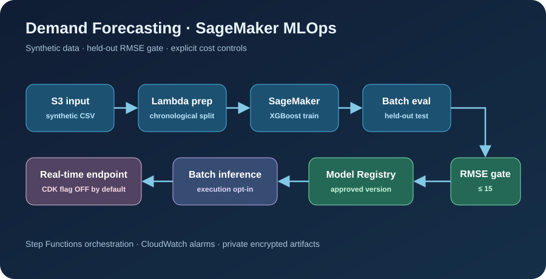
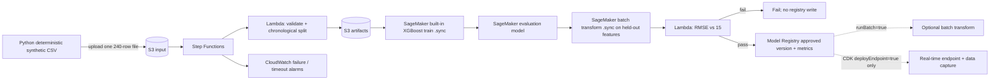

# SageMaker demand forecasting MLOps — PoC #3

A deployable **AWS CDK TypeScript** architecture for Dima Williams' AWS ML Engineering portfolio. This is **source code and local tests, not a deployed demo**. No AWS training run, achieved RMSE, endpoint performance or observed bill is claimed.



## Architecture



- S3 input and artifacts use SSE-S3, block all public access, deny non-TLS and expire objects after 30 days; dev `DESTROY` requires explicit bucket emptying, prod `RETAIN` requires manual lifecycle/retention review. Neither bucket uses auto-delete. Source upload is deliberately separate from stack deployment.
- `scripts/generate_dataset.py` generates exactly 240 deterministic daily rows (weekday, promotional flag, price, demand) with a seeded pseudo-random noise term and no downloads/dependencies. These are **fictional** figures, not real demand. `ml/preprocess.py` enforces schema, date order, finite values, 2 MB/10k-row limits and splits oldest 70% train, next 15% validation, newest 15% held-out test. Run names isolate all artifacts. The CSV is label-first for built-in XGBoost; `ml/train.py` creates train/validation channels and headerless feature-only inference channels. The actual learner runs inside the AWS-maintained built-in algorithm image, not the local Python script. This avoids packaging custom Python dependencies on training instances.
- A single Standard state machine waits on SageMaker training (`ml.m5.large`, 10 GB, 30-minute maximum, 60 boosting rounds) and a batch transform on held-out features (`ml.m5.large`), compares one output per row to labels with RMSE ≤ 15, and **only then** registers an `Approved` package with a metrics JSON URI. Failure leaves a model/training artifacts for inspection but never registers that weak model. This is a demonstrative gate, **not a claim that it passes**; a stopped/failed run can leave resources. Repeated runs use unique execution names; use 1–40 ASCII letters, digits or hyphens so SageMaker job names remain valid. One run at a time is recommended for budget control; no concurrency quota is provisioned.
- Execution input `{"runBatch":true}` requests a second transform on feature-only `batch.csv`, storing output under the run prefix. It runs only **after** passing the metric gate. By default there is no real-time endpoint path. `-c deployEndpoint=true` deliberately adds endpoint configuration and create/wait states after registration; each successful run then provisions an `ml.m5.large` endpoint (ongoing hourly charges) and enables 100% request/response data capture to S3. This is a **real-time** endpoint, not serverless. Because inputs here are synthetic, captured data is illustrative; do not submit real personal data without privacy/retention review. The endpoint is an API in AWS, not a public demo URL. No endpoint is deployed by `cdk deploy` alone; a passing execution is required.
- Runtime IAM roles separate SageMaker, three Lambda functions, and Step Functions. Object permissions are scoped to input key or run/model prefixes; job/model/transform actions are scoped to `ml-*`/`eval-*`/`batch-*`, with scoped `iam:PassRole` to SageMaker. CDK also grants Step Functions log and X-Ray write permissions. Model Registry uses a scoped package group. CloudWatch alarms signal failed or timed-out executions but have **no notification action**: connect a reviewed SNS destination for operations. CDK only synthesizes intent; actual permissions and AWS-managed image behavior must be integration tested.

### Model Monitor data-quality baseline (manual follow-on, not provisioned)

With `deployEndpoint=true`, request/response **data capture is configured**, but **SageMaker Model Monitor baseline and scheduled monitoring are NOT configured or run**. After an approved sandbox run, use SageMaker `DefaultModelMonitor.suggest_baseline` on the **training feature-only CSV** (make a separate `weekday,promo,price`-only sample; do not baseline on label-first train.csv), store `statistics.json` and `constraints.json` in a private artifact prefix, inspect feature ranges/nulls, then create a Model Monitor hourly/daily schedule pointing to captured inference data and that baseline. Add explicit `sagemaker:CreateProcessingJob`/S3/log permissions, violation alarms and a data-capture budget before enabling. Compare drift to a reviewed training baseline; synthetic features do not establish real-world thresholds. No monitor charges occur unless enabled separately. See [Model Monitor documentation](https://docs.aws.amazon.com/sagemaker/latest/dg/model-monitor.html).

## Prerequisites and local checks

Node.js **22**, npm, Python **3.12+**, pytest and boto3 for local import/tests, AWS CLI v2 for optional deployment, CDK bootstrap and a sandbox with SageMaker quota for `ml.m5.large` training, transform, and (if enabled) hosting. The `XgboostImageUri` CloudFormation parameter is **required**; retrieve a region-appropriate current SageMaker built-in XGBoost image URI (e.g. version `3.0-5`) using SageMaker Python SDK v3's `sagemaker.core.image_uris.retrieve('xgboost', region, version='3.0-5')`. Review [AWS container/version guidance](https://docs.aws.amazon.com/sagemaker/latest/dg/xgboost.html) and [regional availability](https://docs.aws.amazon.com/sagemaker/latest/dg/xgboost-how-to-use.html). Do not use `:latest`, and use the same region as the stack. The image URI is a deploy-time **parameter**, not a credential or bundled artifact; some regions/accounts may require additional ECR access/quota configuration. No keys are checked in.

```bash
npm install
npm run lint
npm test
python -m pip install pytest boto3
python -m pytest tests/test_ml.py -x -q
npm run synth -- -c stage=dev
npm run synth -- -c stage=prod
# Inspect opt-in topology without provisioning resources:
npm run synth -- -c stage=dev -c deployEndpoint=true
```

### Deliberate sandbox deployment (after budget and teardown plan)

```bash
# Generate and review a versioned region-specific image URI using the SageMaker Python SDK:
python -m pip install sagemaker
export AWS_REGION=eu-west-2
export XGBOOST_IMAGE_URI="$(python -c 'import os; from sagemaker.core import image_uris; print(image_uris.retrieve("xgboost", os.environ["AWS_REGION"], version="3.0-5"))')"
# Bootstrap once using an authorized role/account; verify that the image is available in this region:
npx cdk bootstrap "aws://$AWS_ACCOUNT_ID/$AWS_REGION"
npx cdk deploy DemandForecastMlops-dev -c stage=dev \
  --parameters "XgboostImageUri=$XGBOOST_IMAGE_URI"
# Use the deployed InputBucketName output, not a guessed bucket name:
python scripts/generate_dataset.py > /tmp/demand.csv
aws s3 cp /tmp/demand.csv "s3://$INPUT_BUCKET/input/demand.csv"
aws stepfunctions start-execution --state-machine-arn "$STATE_MACHINE_ARN" \
  --name "forecast-$(date +%s)" --input '{"runBatch":false}'
# Inspect execution history; on success review runs/<name>/evaluation/metrics.json in ArtifactBucketName.
# For opt-in batch, set runBatch=true. For endpoint, separately re-deploy with -c deployEndpoint=true,
# then start a new execution only after budget/teardown approval.
```

The caller needs `s3:PutObject` on the exact input key and `states:StartExecution` on the state machine; neither user principal is created here. Dev and prod stages share the caller's account unless you deliberately separate accounts. Only the **first** execution with a new name can use that name until Step Functions name retention expires; use a new run name each time. CloudFormation parameter updates must retain/provide the XGBoost URI on re-deploy. An absent input object fails at preparation. No public data or image download is needed for local tests.

### Teardown first — especially endpoints

**Before any endpoint-enabled execution, plan to remove the endpoint immediately after inspection.** Teardown does NOT happen automatically when the Step Functions run ends. Confirm no active training/transform/endpoint operations and inventory all run names and SageMaker resources. The model package group may block stack deletion while versions exist. No automatic state-machine retries are configured for non-idempotent create calls; after any failure inspect for partially created resources before rerunning with a fresh execution name. For each run, in order:

```bash
# ONLY for a known dev run; replacing RUN with its execution name (the ml- prefix is added by the workflow):
aws sagemaker delete-endpoint --endpoint-name "ml-$RUN"          # only if created
# Wait until DescribeEndpoint reports not found before deleting config/model:
aws sagemaker delete-endpoint-config --endpoint-config-name "ml-$RUN" # only if created
aws sagemaker delete-model --model-name "ml-$RUN"                # if created
# List versions first; delete only versions in the dev group, each by exact ARN:
aws sagemaker list-model-packages --model-package-group-name demand-forecast-dev
aws sagemaker delete-model-package --model-package-name "$MODEL_PACKAGE_ARN"
# Inspect remaining versions before deleting stack. Only known dev buckets, destructive:
aws s3 rm "s3://$INPUT_BUCKET/" --recursive
aws s3 rm "s3://$ARTIFACT_BUCKET/" --recursive
npx cdk destroy DemandForecastMlops-dev -c stage=dev
```

Do not run destructive bucket commands against prod; prod bucket objects are retained on stack deletion (but 30-day expiration still applies). SageMaker Model Registry group deletion can fail if package versions remain. Stop in-flight jobs if necessary (`stop-training-job`, `stop-transform-job`), verify endpoint deletion has completed, and investigate orphaned resources and CDK bootstrap assets after destroy. Hosted endpoints continue charging until deleted, **even when unused**. Model Monitor schedule (if you created one manually) and any CloudWatch logs outside this stack also require separate cleanup.

## CI/CD security

`.github/workflows/ci.yml` runs lint, assertion/unit tests and synth on pushes/PRs; deployment only runs through `workflow_dispatch` with stage and an explicit `deployEndpoint` input defaulting false. Configure GitHub environment `dev`/`prod` approvals, `AWS_REGION` and `XGBOOST_IMAGE_URI` environment variables and `AWS_DEPLOY_ROLE_ARN` environment secret. Restrict OIDC role trust to this exact repository, intended ref and environment; scope permissions to CDK bootstrap, the target stack, IAM provisioning, S3, SageMaker, Lambda, Step Functions, CloudWatch and logs. `npm install` is deliberate because lockfiles are not pushed. The workflow does **not** start a training execution. Set AWS Budgets externally.

## Well-Architected review (design-time, not an audit)

**Operational Excellence** — One state machine coordinates runs; tests, synth, logs and failure/timeout alarms are included. Add actionable alarm destinations, runbooks, end-to-end deployed tests and drift checks before production.

**Security** — SSE-S3, TLS-only, block public access, scoped runtime roles, no committed secrets. SSE-S3 is not a customer-managed key, SageMaker execution images and account permissions need verification, and real data requires classification, encryption and capture/privacy review. CI OIDC trust is configured outside this repo.

**Reliability** — Ordered time split avoids random temporal leakage; RMSE gate rejects weak models before registration. The Lambda preparation overwrites a run's files if rerun with the same execution name (Step Functions disallows a second execution of that name); no transactional snapshots or schema evolution. Timeouts and failures may leave SageMaker models/resources; implement janitor controls and retry/idempotency tests for production.

**Performance Efficiency** — Small data makes SageMaker cold start dominant; instance choices are illustrative, not benchmarked. Profile realistic volume before scaling training or choosing online hosting.

**Cost Optimization** — Endpoint path OFF by default; no schedules start executions. Training and two batch-transform instances are billed per run; opt-in batch adds another transform. SSE-S3 requests/storage, Lambda, Step Functions transitions, CloudWatch logs/metrics, model registry and data capture may cost money. **Real-time endpoints charge continuously even at zero requests** and can dominate the bill. Set budget alerts and a teardown timer before enabling endpoint deployments.

**Sustainability** — Reproducible tiny synthetic sample avoids external transfers; running SageMaker instances for 240 rows is intentionally inefficient for illustration. Use a local or serverless option for genuinely small workloads; no energy impact measured.

## Illustrative cost note (not a bill)

For a **hypothetical** one-off sandbox run, expect charges for one `ml.m5.large` training job (up to 30 minutes), one `ml.m5.large` batch evaluation job (plus another if batch inference is requested), S3 storage/requests, Lambda, state transitions and CloudWatch. Compute startup/minimum billable time and region pricing vary; no measured or promised price is given. An opt-in real-time `ml.m5.large` endpoint bills **hourly while provisioned, indefinitely until deleted**; do not enable it without an account [budget](https://aws.amazon.com/aws-cost-management/aws-budgets/) and an immediate delete plan. Model Monitor scheduled processing (not provisioned) adds compute charges. Check the [AWS Pricing Calculator](https://calculator.aws/) in your region, confirm quotas and choose a spending cap before any run.

## Results: Pending deployment

Local unit/CDK assertion tests and synthesis validate source-code behavior and intended CloudFormation only. No SageMaker train/transform execution, actual RMSE, registration, endpoint status, Model Monitor baseline, latency, alarm notification or AWS spend has been observed. A sandbox validation should record execution name, threshold/metric, model package ARN, transform/endpoint status, full teardown and actual billing.

## Caveats

- Container-image support and SageMaker/Step Functions API field compatibility need live integration testing. Model approval is automatic on pass for demo purposes; production should require human review. The RMSE threshold of 15 is illustrative; choose against a real baseline and business loss function.
- XGBoost built-in `text/csv` single-row transform output is assumed to contain one floating-point prediction per line; check container version output format. The local tests validate the parser and gate but not container-specific output or model quality.
- `DataCaptureConfig` captures inputs/outputs only; **no automatic SageMaker Model Monitor baseline or monitoring schedule** is created. For production also add endpoint-specific 5XX/latency alarms after endpoint names exist, VPC/private network controls, data minimization and a provisioned resource cleanup automation.
